# TERRA-X — Comprehensive Platform Guide & Technical Manual
**Planetary Intelligence & Earth Analogs Discovery**  
*NASA Space Apps Challenge 2026 Reference Manual & Operational Documentation*  
*Target Challenge: "Identify Earth Locations that Analog the Permanent Moon Base Locations and Mars"*

---

## Document Control & System Specifications

| Specification | Details |
| :--- | :--- |
| **Document Title** | TERRA-X Comprehensive Technical Platform Guide & User Manual |
| **System Version** | Release 1.0.0-POC (Production-Grade Zero-Build Architecture) |
| **Challenge Track** | NASA Space Apps Challenge 2026: Permanent Moon Base Locations and Mars |
| **Planetary Target Bodies** | Mars (*Areoid Reference*), Moon (*Selenocentric Polar & Equatorial*) |
| **Coordinate Systems** | Mars: `IAU_2015:49900` (Equirectangular); Moon: `IAU_2015:30135` (South Pole Stereographic) / `IAU_2015:30100` |
| **Primary Authors / Team** | TERRA-X Science & Engineering Consortium |
| **Ground-Truth Baseline** | NASA Planetary Data System (PDS), USGS Astrogeology, Copernicus ESA GLO-30, Oberlin et al. (2018) |
| **Interactive Workbench** | `http://127.0.0.1:8088/workbench.html` (Local) / `/workbench` |

---

## Table of Contents

1. [Executive Overview & Mission Purpose](#1-executive-overview--mission-purpose)
2. [Foundational Scientific Axiom & Architectural Paradigm](#2-foundational-scientific-axiom--architectural-paradigm)
3. [System Architecture & Data Flow Pipeline](#3-system-architecture--data-flow-pipeline)
4. [The Editorial Landing Portal](#4-the-editorial-landing-portal)
5. [Authentication, Access Control & Route Guard](#5-authentication-access-control--route-guard)
6. [The Interactive Scientific Workbench (Modules 01–08)](#6-the-interactive-scientific-workbench-modules-0108)
   - [Module 01: Planetary Explorer](#module-01-planetary-explorer)
   - [Module 02: Earth Discovery Engine](#module-02-earth-discovery-engine)
   - [Module 03: Geospatial Layers & Scientific Guardrails](#module-03-geospatial-layers--scientific-guardrails)
   - [Module 04: Similarity & Decision Engine](#module-04-similarity--decision-engine)
   - [Module 05: 3D Terrain Digital Twin](#module-05-3d-terrain-digital-twin)
   - [Module 06: Scientific AI Copilot](#module-06-scientific-ai-copilot)
   - [Module 07: Mission Scenario Simulator](#module-07-mission-scenario-simulator)
   - [Module 08: Scientific Report Generator](#module-08-scientific-report-generator)
7. [Comprehensive Earth Analog Catalog & Benchmark Analysis](#7-comprehensive-earth-analog-catalog--benchmark-analysis)
8. [REST API Specification & Programmatic Access](#8-rest-api-specification--programmatic-access)
9. [Automated Verification, Unit Testing & Quality Assurance](#9-automated-verification-unit-testing--quality-assurance)
10. [Academic Bibliography & Open Science Provenance](#10-academic-bibliography--open-science-provenance)

---

## 1. Executive Overview & Mission Purpose

### 1.1 The NASA Space Apps Challenge 2026 Mandate
Humanity has entered a transformative era of planetary exploration. Under NASA's **Artemis Program**, international space agencies and commercial partners are preparing for long-duration human habitations at the **Lunar South Pole** (e.g., Shackleton Crater Rim, Connecting Ridge), while robotic rovers (*Perseverance*, *Curiosity*, and the upcoming *ExoMars Rosalind Franklin*) systematically prospect Martian ancient lake basins and clay-rich plains (*Jezero Crater*, *Gale Crater*, *Oxia Planum*).

Testing surface mobility hardware, regolith drill mechanisms, life-detection instrumentation, and habitat construction techniques directly on the Moon or Mars is prohibitively expensive, risky, and logistically unrepeatable. Planetary exploration teams depend fundamentally on **Terrestrial Analogs**—locations on Earth that preserve environmental, geochemical, mineralogical, or morphological conditions comparable to extraterrestrial destinations.

However, historical analog site selection has suffered from three critical deficiencies:
1. **Ad-Hoc Subjectivity**: Candidate locations are frequently chosen based on qualitative resemblance or historical precedent rather than quantitative multi-sensor metric evaluation.
2. **The "Single Percentage" Fallacy**: Platforms frequently claim an Earth site is "89% identical to Mars," ignoring the profound reality of Earth's dense atmosphere, hydrologic cycle, and pervasive biosphere.
3. **Operational Blind Spots**: High scientific similarity often masks extreme logistical hazards, unnavigable boulder fields, or severe legal restrictions that disqualify a site for actual rover deployment.

### 1.2 TERRA-X Value Proposition
**TERRA-X** (*Planetary Intelligence & Earth Analogs Discovery*) is an integrated, publication-grade decision engine that bridges planetary remote sensing and terrestrial fieldwork. By ingesting calibrated datasets from the **NASA Planetary Data System (PDS)**, **USGS Astrogeology**, and **Copernicus ESA**, TERRA-X matches target Areas of Interest (AOIs) on the Moon and Mars with candidate terrestrial testbeds worldwide.

The platform provides an end-to-end operational environment featuring interactive 2D GIS map canvases, side-by-side 3D terrain elevation meshes, real-time perturbation sensitivity audits ($\pm 15\%$), a deterministic grounded AI Copilot, and one-click multi-format report exports (PDF, Word, CSV, GeoJSON).

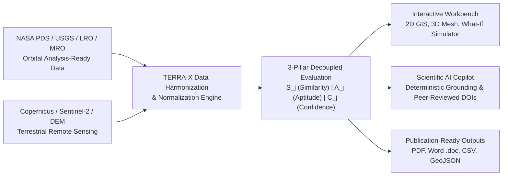

---

## 2. Foundational Scientific Axiom & Architectural Paradigm

### 2.1 The Foundational Axiom (Osinski et al., 2006; Oberlin et al., 2018)
Every calculation, comparison, and recommendation generated by TERRA-X is governed by a non-negotiable scientific principle:

> **"A terrestrial analog reproduces specific relevant physical, mineralogical, or geochemical properties, never Mars or the Moon in their entirety."**  
> — *G. R. Osinski et al. (Planetary and Space Science, 2006); E. A. Oberlin, M. W. Claire, & S. P. Kounaves (Astrobiology, 2018)*

Earth's ambient oxygenation, $1\text{ bar}$ atmospheric pressure, hydrologic rainfall cycle, and pervasive organic contamination cannot be erased. An Earth analog is scientifically meaningful **only within bounded parameters**. For example:
- **Tindouf Basin Sebkha (North Africa)** replicates the soil perchlorate, sulfate, and chlorate ionic ratios discovered by the Phoenix Mars Lander and Curiosity rover, but operates in a terrestrial atmosphere with seasonal heat.
- **University Valley, McMurdo Dry Valleys (Antarctica)** reproduces dry permafrost sublimation and cryogenic thermal contraction crack polygons, but exhibits terrestrial solar radiation and polar oxygen.
- **Atacama Desert Yungay Core (Chile)** matches hyperarid desiccation and extreme organic detection limits, but does not match Lunar vacuum or Martian atmospheric pressure ($6\text{ mbar}$).

### 2.2 The Decoupled 3-Pillar Decision Framework
To eliminate the mathematical fraud of a single unweighted matching score, TERRA-X implements a **3-Pillar Decoupled Decision Framework**:

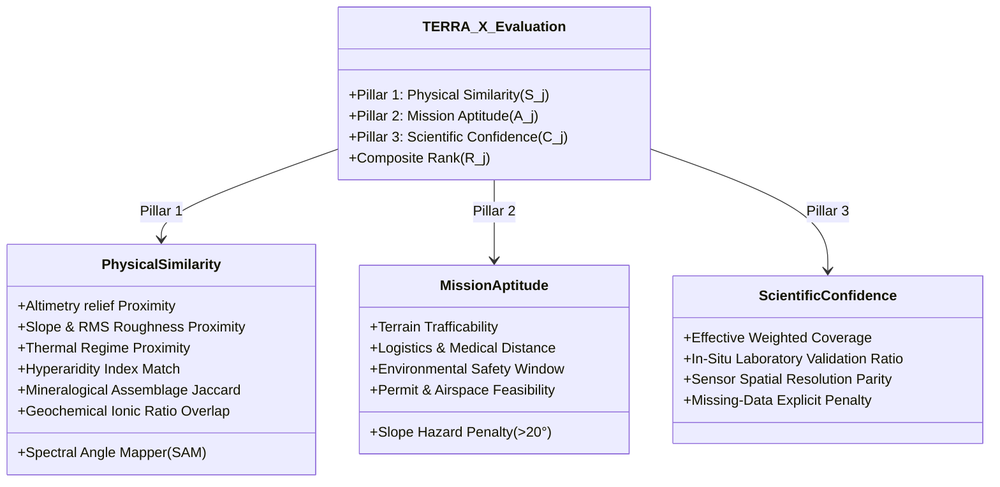

#### Pillar 1: Physical Similarity ($S_j$)
Physical similarity measures how closely candidate terrestrial variables match the planetary target AOI across physically comparable axes:
$$S_j = \frac{\sum_{i \in \text{Observed}} w_i \cdot s_{ij}}{\sum_{i \in \text{Observed}} w_i}$$
where $s_{ij} \in [0, 1]$ represents the normalized proximity for criterion $i$ on site $j$, and $\sum w_i = 1.0$.

#### Pillar 2: Mission Aptitude ($A_j$)
Scientific resemblance is useless if a rover cannot operate safely. Mission Aptitude integrates field engineering feasibility, rover trafficability, logistics, and personnel safety:
$$A_j = 0.68 \cdot S_j + 0.18 \cdot \text{Access}_j + 0.14 \cdot \text{Safety}_j - P_{\text{slope}}$$
where $P_{\text{slope}} = \min\left(0.35, (\alpha_{\text{site}} - \alpha_{\text{safe}}) \cdot 0.03\right)$ applies an immediate engineering penalty if the site's slope exceeds the rover mission threshold (e.g., $20^\circ$).

#### Pillar 3: Scientific Confidence ($C_j$)
Confidence measures the empirical certainty, measurement resolution, and ground-truth validation backing the score:
$$C_j = 0.50 \cdot \Omega_j + 0.30 \cdot R_{\text{in-situ}} + 0.20 \cdot R_{\text{high-res}} - 0.08 \cdot N_{\text{missing}}$$
where $\Omega_j$ is the effective weighted data coverage, $R_{\text{in-situ}}$ is the fraction of measurements verified through laboratory field sampling, $R_{\text{high-res}}$ is the fraction of sensor data with ground sampling distance $\le 100\text{ m}$, and $N_{\text{missing}}$ penalizes missing or unmeasured criteria.

> [!IMPORTANT]
> **Zero Imputation Policy**: Missing criteria are **never** filled with default numbers (such as 0 or 1). Instead, weights are redistributed across observed variables, while the missing variables explicitly downgrade the Confidence score ($C_j$).

---

## 3. System Architecture & Data Flow Pipeline

TERRA-X is engineered for high performance, maximum portability, and complete zero-build autonomy. It requires no heavy database engines, no external node runtimes, and no fragile build chains.

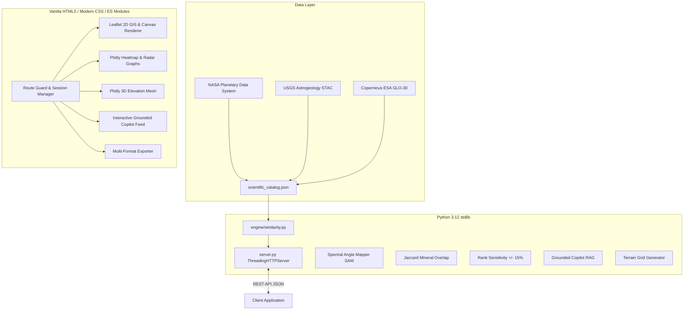

---

## 4. The Editorial Landing Portal

The public gateway of TERRA-X is an editorial, cinematic web experience designed to introduce researchers, mission planners, and the public to the scientific imperative of planetary analog discovery.

### 4.1 Cinematic Orbital Hero Header
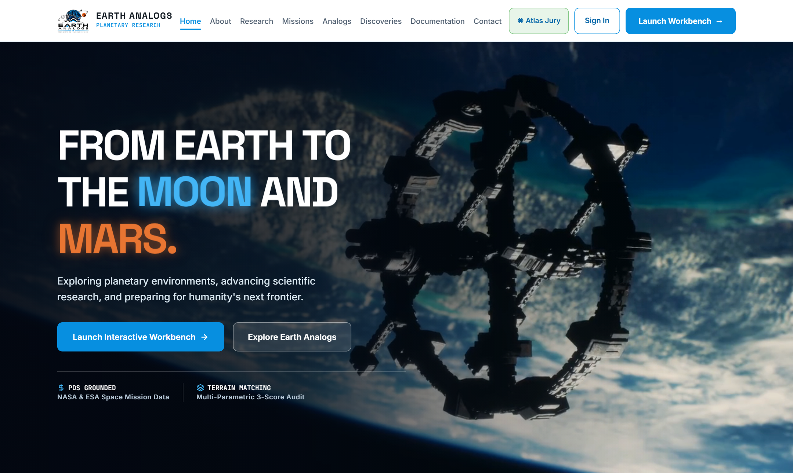  
*Figure 1: The TERRA-X landing portal featuring a cinematic 4K orbital video background, mission badge, real-time metrics pill, and dual launch action CTAs.*

The hero section ([static/index.html](./static/index.html#L70-L144)) immerses the user in deep space exploration:
- **Atmospheric Video Engine**: Loads an orbital space exploration background loop (`189457-885804464_medium.mp4`) with an overlaid orbital scrim and dynamic cosmic particle drift animation.
- **Mission Badge & Title**: Features the official NASA Space Apps Challenge 2026 track header, declaring *"Identify Earth Locations that Analog the Permanent Moon Base Locations and Mars"*.
- **Metrics Strip**: Displays real-time catalog statistics:
  - `8 Verified Global Analogs` across 5 continents.
  - `5 High-Priority Planetary AOIs` (Jezero, Oxia, Gale, Shackleton, Mare Tranquillitatis).
  - `6 Calibrated Remote Sensing Layers` (Altimetry, Slope, Temperature, Aridity, Mineralogy, Geochemistry).
  - `100% Deterministic Grounding` tied to peer-reviewed DOIs.
- **Action Controls**:
  - `Launch Scientific Workbench` button: Direct access to the authenticated research dashboard.
  - `Explore Analogs Catalog` button: Smooth-scrolls directly to the planetary comparison matrix.
  - `1-Click Demo Access`: Instantly bypasses credentials for evaluation review.

### 4.2 Section 03 — About & Tindouf Core Sampling
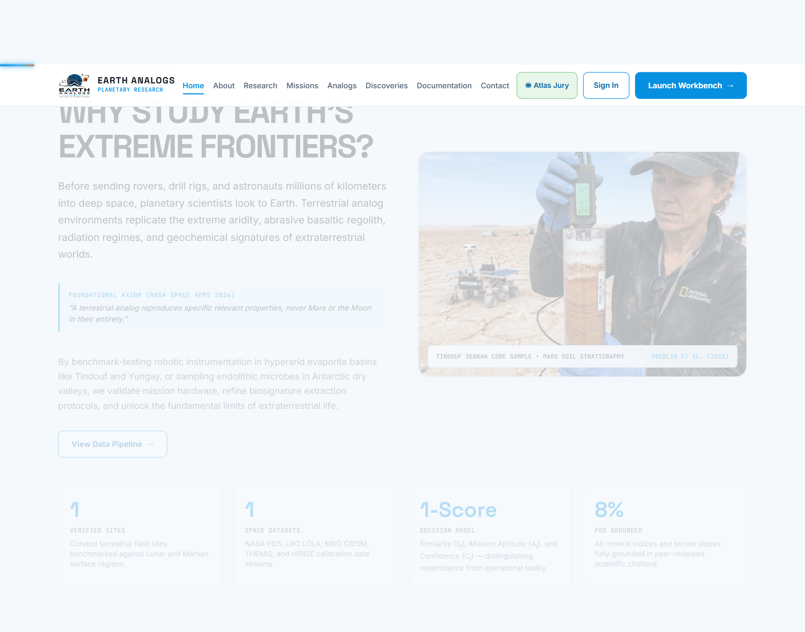  
*Figure 2: Section 03 highlighting the scientific research of Oberlin et al. (2018) on Tindouf Basin evaporites matching Martian Phoenix Lander soil chemistry.*

This section establishes the empirical justification for the platform:
- **The Soil Geochemistry Breakthrough**: Spotlights the research by **Oberlin, Claire, & Kounaves (2018)** (*Astrobiology*, DOI: [10.1089/ast.2016.1557](https://doi.org/10.1089/ast.2016.1557)). It illustrates how evaporite crusts and hyperarid sebkhas in the **Tindouf Basin** (Algeria/Morocco border) naturally synthesize and preserve oxychlorines (perchlorates $\text{ClO}_4^-$ and chlorates $\text{ClO}_3^-$) with ionic ratios matching the Phoenix Lander's Wet Chemistry Laboratory (WCL).
- **Interactive Stratigraphic Visual**: Presents a multi-layered core sample simulation showing the halite-gypsum cap, oxychlorine-bearing saline horizon, and clay-rich Noachian bed.
- **Scientific Callout**: Quotes the foundational axiom to clarify why Tindouf is an extraordinary soil chemistry analog, but not a gravity or atmospheric analog.

### 4.3 Section 04 — Research Domains & Modular Architecture
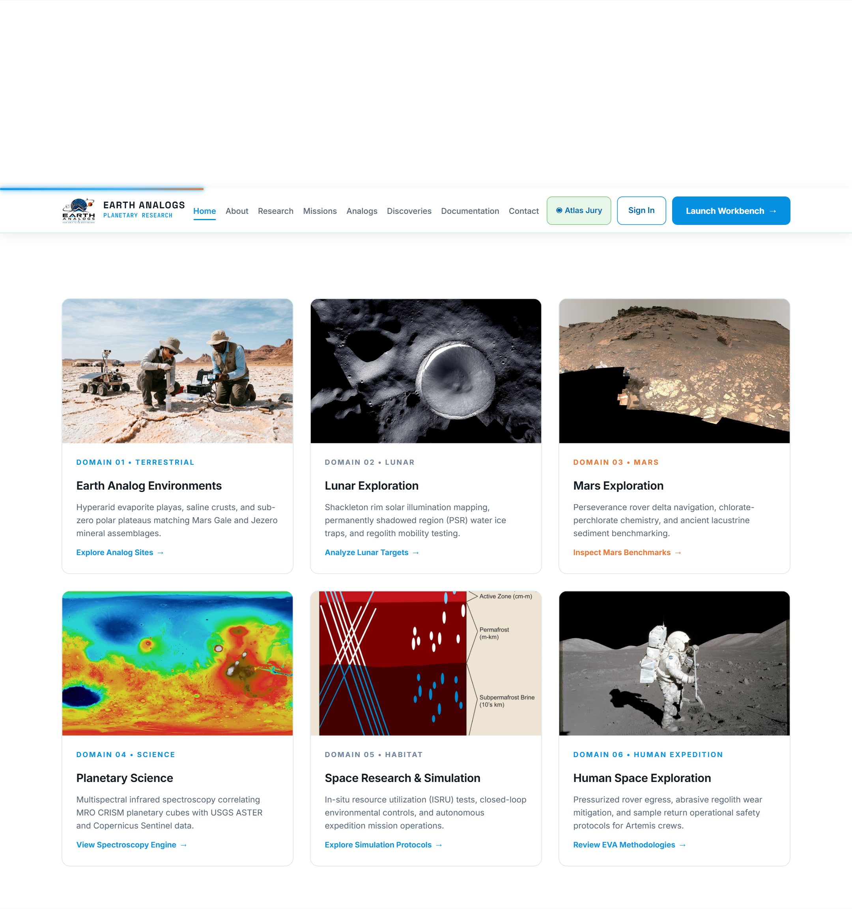  
*Figure 3: Interactive cards detailing the 8 integrated modules of the TERRA-X platform.*

Provides an interactive grid displaying the 8 functional pillars of the platform:
1. `01 Planetary Explorer`: Multi-spectral and altimetric characterization of Moon and Mars target AOIs.
2. `02 Earth Discovery`: Multi-tiered global and regional screening filters.
3. `03 Geospatial Layers`: Calibrated geophysical, thermal, and geochemical rasters.
4. `04 Similarity & Decision`: Decoupled 3-pillar scoring engine with rank stability checks.
5. `05 3D Digital Twin`: Micro-topography wireframes and elevation transect cross-sections.
6. `06 Scientific AI Copilot`: Strict citation-grounded conversational intelligence.
7. `07 Mission Simulator`: Pre-configured field testing operational profiles.
8. `08 Report Generator`: Audit-compliant scientific reporting in four formats.

### 4.4 Section 05 — Missions & Soil Adaptation Split
  
*Figure 4: Section 05 illustrating the four pre-set mission operational profiles and regolith mechanics.*

This section highlights the critical link between target mission goals and field conditions:
- **Mission Profiles**: Detailed breakdowns of Scenarios A, B, C, and D.
- **Regolith & Trafficability Matrix**: Compares wheel-slip mechanics, cohesion, internal friction angles, and boulder hazards between Lunar South Pole agglutinates, Martian basaltic regolith, and terrestrial evaporite salt flats.

### 4.5 Section 06 — The Planetary Trio
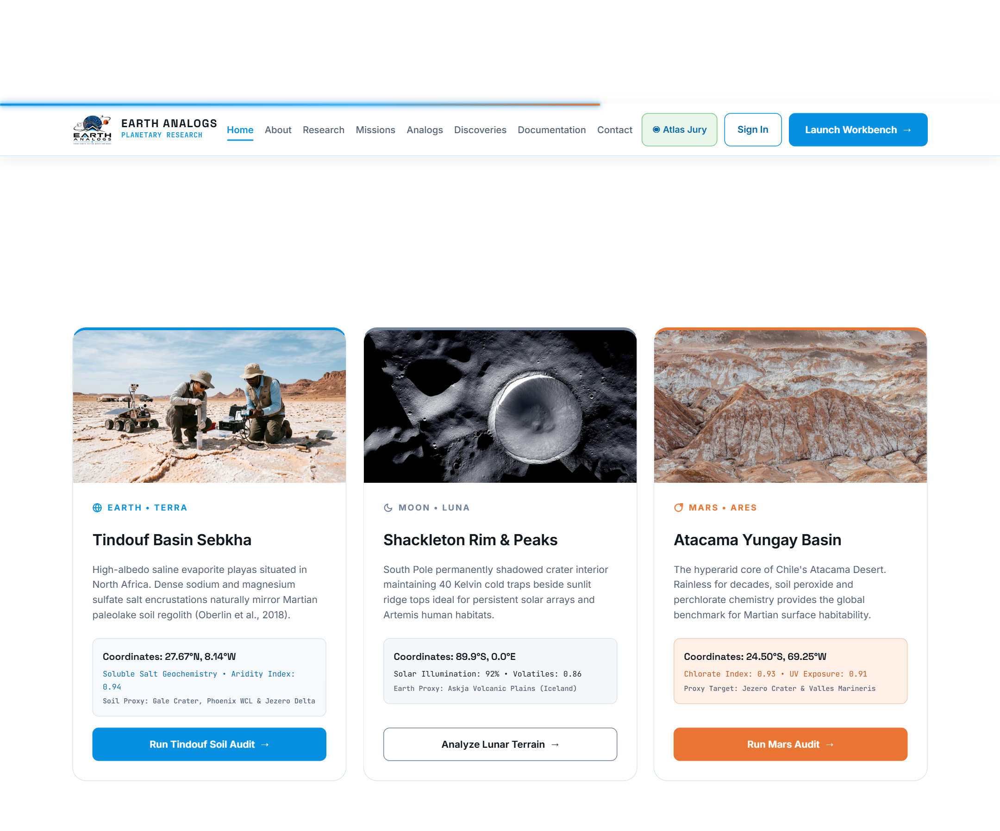  
*Figure 5: Comparative planetary trio: Mars (Ancient Basins), Moon (Polar Ice & Pits), and Earth (Analog Havens).*

Presents a side-by-side comparative architectural triad:
- **Mars**: Focuses on phyllosilicate clays, sulfate mounds, and relict fluvial deltas.
- **The Moon**: Focuses on Permanently Shadowed Regions (PSRs), water ice traps, and basalt collapse pits.
- **Earth**: Highlights extreme environments that capture specific slivers of extraterrestrial reality.

---

## 5. Authentication, Access Control & Route Guard

Security and identity management in TERRA-X provide authenticated researcher access while maintaining zero-database portability through an encrypted, client-persisted session model.

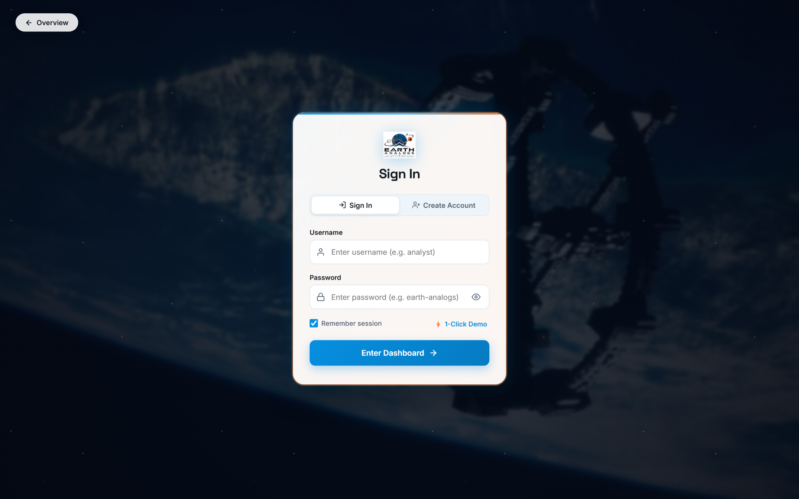  
*Figure 6: The TERRA-X Analyst Authentication interface with cosmic particles, credential validation, and 1-Click Demo login.*

### 5.1 Architecture & Route Protection ([static/js/auth.js](./static/js/auth.js))
- **Route Guard Mechanism**: When a user accesses `/workbench.html` or `/workbench`, the system immediately verifies the existence and validity of `localStorage.getItem("terra_x_session")`.
- **Automatic Redirect**: If unauthenticated or if the session has expired, the user is redirected to `/login.html?redirect=/workbench.html`.
- **Session Lifespan**: Standard sessions remain valid for 24 hours. Selecting *"Remember session"* extends the token lifecycle to 30 days.

### 5.2 Pre-Configured Verified Research Accounts
For rapid evaluation and mission team testing, the platform is pre-seeded with three verified scientist personas:

| Username | Default Password | Scientist Persona | Role & Research Clearance |
| :--- | :--- | :--- | :--- |
| `analyst` | `earth-analogs` | **Dr. Sarah Chen** | Lead Astrobiologist & Mission Specialist (`Level 3`) |
| `admin` | `nasa2026` | **Commander M. Jadir** | Chief Planetary Exploration Director (`Level 4`) |
| `nasa` | `moon-and-mars` | **Alex Vance** | Autonomous Rover & Terrain Analyst (`Level 2`) |

### 5.3 Interactive Login Controls
- **Username / Password Inputs**: Form fields with real-time format validation (`#inputUsername`, `#inputPassword`).
- **Show/Hide Password Toggle**: Eye icon button (`#btnTogglePass`) toggles password masking.
- **1-Click Quick Demo**: The `#btnQuickDemo` button instantly populates the `analyst` credentials and transitions to the workbench within 300 milliseconds.
- **New Account Registration**: The *"Register New Account"* tab allows researchers to create unique local accounts with custom roles and security clearance levels.

---

## 6. The Interactive Scientific Workbench (Modules 01–08)

The TERRA-X Workbench (`/workbench.html`) is the analytical cockpit of the platform. It is structured into three synchronized zones:
1. **Left Control Column**: Host to Module 01 (Planetary Explorer), Module 02 (Earth Discovery), Module 03 (Geospatial Layers), and Module 07 (Mission Simulator).
2. **Center Analytical Stage**: Tabbed display hosting 2D Discovery Maps, Module 04 (Similarity Heatmap & Decision Matrix), Module 05 (3D Digital Twin), and Module 08 (Scientific Report Generator).
3. **Right Intelligence Column**: Host to Module 06 (Scientific AI Copilot).

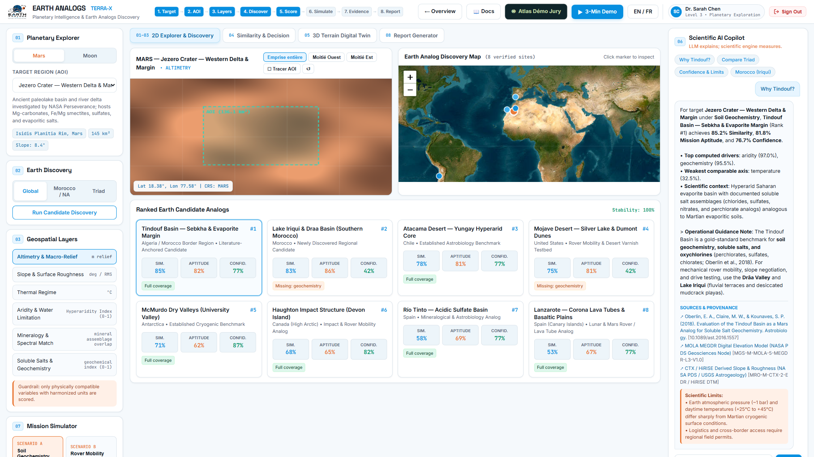  
*Figure 7: Module 01–03 dual-canvas planetary and terrestrial exploration view with live candidate rankings and custom polygon draw capability.*

---

### Module 01: Planetary Explorer

Module 01 governs the selection, boundary definition, and remote-sensing inspection of target extraterrestrial sites.

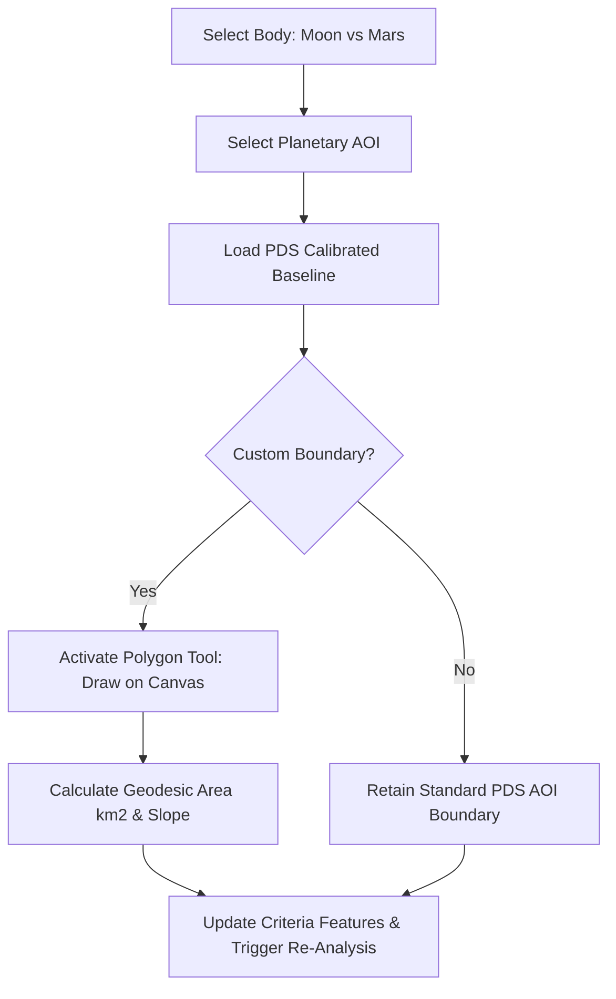

#### Operational Controls:
1. **Target Body Segmented Toggle (`#planet-toggle`)**:
   - `Mars` Button: Switches coordinate frame to Mars `IAU_2015:49900`, loads Mars PDS orbital baselines (MOLA, CRISM, THEMIS), and activates Mars AOIs.
   - `Moon` Button: Switches coordinate frame to Moon `IAU_2015:30135` (South Pole) / `IAU_2015:30100` (Equatorial), loads LRO baselines (LOLA, LROC NAC), and **triggers the physical aridity guardrail**.
2. **Planetary AOI Selector (`#aoi-select`)**:
   - *Jezero Crater — Western Delta & Margin* (Mars, $145.0\text{ km}^2$): Ancient fluvial delta, rich in smectite clays and carbonates.
   - *Oxia Planum — Clay-Bearing Plain* (Mars, $210.0\text{ km}^2$): ExoMars landing target; widespread Noachian Fe/Mg-phyllosilicates.
   - *Gale Crater — Mount Sharp Sulfate Unit* (Mars, $180.0\text{ km}^2$): Curiosity exploration path; transitioning from clay to magnesium sulfate layers.
   - *Shackleton Crater Rim — South Pole Base AOI* (Moon, $64.0\text{ km}^2$): Artemis permanent base target; ultra-steep slopes ($28^\circ$), permanently shadowed cryogenic traps, continuous peak illumination.
   - *Mare Tranquillitatis — Basalt Pit & Regolith* (Moon, $95.0\text{ km}^2$): Sub-surface lava tube skylight candidate, thick titanium-rich basaltic regolith.
3. **Custom AOI Polygon Drawing Tool (`#btn-draw-aoi`)**:
   - Clicking this tool activates the freehand polygon drawing cursor on the planetary canvas.
   - Clicking boundary vertices constructs a customized mission bounding box.
   - Clicking *"Finish AOI"* or double-clicking closes the loop, triggers real-time spherical area computation ($\text{km}^2$), recalculates the enclosed mean slope, and posts the custom geometry to the backend via `POST /api/regions/planetary`.
4. **Metadata & Coordinate Badges (`#aoi-meta-pills`)**:
   - Dynamically displays the target region name, total surface area ($\text{km}^2$), mean topographic slope ($^\circ$), and standard IAU Coordinate Reference System (CRS).

---

### Module 02: Earth Discovery Engine

Module 02 provides spatial and regional screening filters to discover candidate terrestrial analog sites across the globe.

#### Operational Controls:
1. **Discovery Scope Segmented Filter (`#discovery-toggle`)**:
   - `Global` Mode: Searches the full international catalog (Antarctica, South America, North America, Europe, Africa).
   - `Morocco / NA` Mode: Isolates regional candidates in Morocco and North Africa (Tindouf Basin, Lake Iriqui, Draa Basin) to evaluate local fieldwork accessibility.
   - `Triad` Benchmark Mode: Restricts screening to the scientific benchmark triad (**Tindouf Sebkha**, **Atacama Yungay**, **McMurdo Dry Valleys**).
2. **Run Candidate Discovery CTA (`#btn-discover`)**:
   - Executes `POST /api/discovery/jobs` with the current slope ceiling and aridity parameters.
   - Updates the Leaflet Earth Map (`#earth-map`), clusters candidate site pins, and color-codes rank badges (#1 through #8).
3. **Ranked Candidate Site Cards (`#candidate-cards`)**:
   - Selecting any candidate card highlights its pin on the map, updates the center-stage telemetry, synchronizes the 3D Digital Twin, and adjusts the Copilot context.

---

### Module 03: Geospatial Layers & Scientific Guardrails

Module 03 displays the multi-spectral, geophysical, and environmental layers that drive the matching algorithm.

#### The 6 Calibrated Remote-Sensing Criteria:
1. **Altimetry & Macro-Relief (`altimetry`)**:
   - Measures local elevation range ($\Delta h = h_{\max} - h_{\min}$ within AOI) in meters.
   - Normalization Scale: $2,500.0\text{ m}$.
2. **Slope & Surface Roughness (`slope_roughness`)**:
   - Measures mean topographic inclination and high-frequency RMS step roughness.
   - Normalization Scale: $35.0^\circ$.
3. **Thermal Regime (`temperature`)**:
   - Measures mean extreme ambient temperatures in degrees Celsius.
   - Normalization Scale: $120.0^\circ\text{C}$.
4. **Aridity & Water Limitation (`aridity`)**:
   - Hyperaridity Index evaluated from precipitation/evapotranspiration ratios.
   - Normalization Scale: $1.0$.
5. **Mineralogy & Spectral Match (`mineralogy`)**:
   - Spectral Angle Mapper (SAM) dot product and mineral assemblage Jaccard index.
   - Normalization Scale: $1.0$.
6. **Soluble Salts & Geochemistry (`geochemistry`)**:
   - Soluble oxychlorine, nitrate, and sulfate salt concentrations and ionic ratios.
   - Normalization Scale: $1.0$.

#### The Lunar Vacuum Physical Guardrail
When the user selects **Moon** in Module 01:
- The system automatically triggers the **Physical Guardrail Engine**.
- The `aridity` layer is dynamically disabled, labeled **"EXCLUDED BY GUARDRAIL"**, and grayed out.
- A prominent alert banner notifies the user:
  > *Guardrail: 'Aridity' is excluded for Lunar targets (no comparable atmosphere or hydrological cycle).*
- The weight assigned to aridity is redistributed proportionally across the remaining 5 observed criteria, preventing mathematical distortion.

---

### Module 04: Similarity & Decision Engine

Module 04 renders the mathematical core of TERRA-X, converting multi-criteria measurements into transparent, defensible rankings.

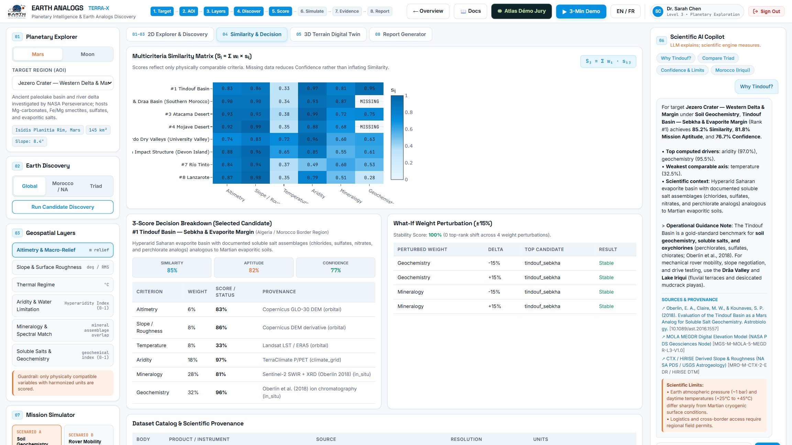  
*Figure 8: Tab 04 displaying the Plotly Similarity Matrix Heatmap, the 3-Score Selected Site Breakdown, the Rank Stability Panel, and the Data Provenance Table.*

#### 1. The Similarity Matrix Heatmap (`#similarity-heatmap`)
- Built with **Plotly.js**, this interactive heatmap renders candidate sites along the Y-axis and the 6 criteria along the X-axis.
- Each cell displays the exact computed proximity score ($s_{ij} \in [0.00, 1.00]$).
- Missing data is rendered with an explicit `"MISSING"` label; guardrail exclusions are rendered with `"GUARDRAIL"`.

#### 2. Selected Site 3-Pillar Breakdown Panel (`#selected-site-breakdown`)
- Displays three large telemetry gauges for the currently active site:
  - **Similarity ($S_j$)**: Rendered in Cyan (`#078FE0`).
  - **Mission Aptitude ($A_j$)**: Rendered in Amber (`#E87532`).
  - **Scientific Confidence ($C_j$)**: Rendered in Emerald Green (`#22C55E`).
- A tabular breakdown contrasts the raw planetary AOI value against the terrestrial value, displaying units, weights, and normalized proximity.

#### 3. Perturbation Sensitivity & Rank Stability Engine
To satisfy rigorous space agency mission planning requirements, TERRA-X tests whether rankings are brittle:
- The engine identifies the top 2 weighted criteria in the current scenario.
- It applies a $\pm 15\%$ perturbation to their normalized weights:
  $$w'_k = w_k \cdot (1 \pm 0.15)$$
- It re-normalizes the weight vector and recalculates rankings across all candidate sites.
- **Rank Stability Score**:
  $$\text{Stability} = 1.0 - \frac{\text{Flips}}{\text{Total Tests}}$$
- If the #1 ranked candidate remains unchanged across all 4 perturbation scenarios, the system reports **100% Stability** (Rock-Solid Ranking).

#### 4. Data Provenance & Sensor Table (`#provenance-table`)
- Lists the full lineage of every data point: mission origin, sensor instrument (e.g., *MRO CRISM*, *LRO LOLA*, *Copernicus GLO-30*), ground sampling distance (GSD), and measurement type (*orbital remote sensing* vs *in-situ laboratory analysis*).

---

### Module 05: 3D Terrain Digital Twin

Module 05 generates interactive, side-by-side 3D elevation relief models comparing the planetary target AOI with the selected Earth candidate.

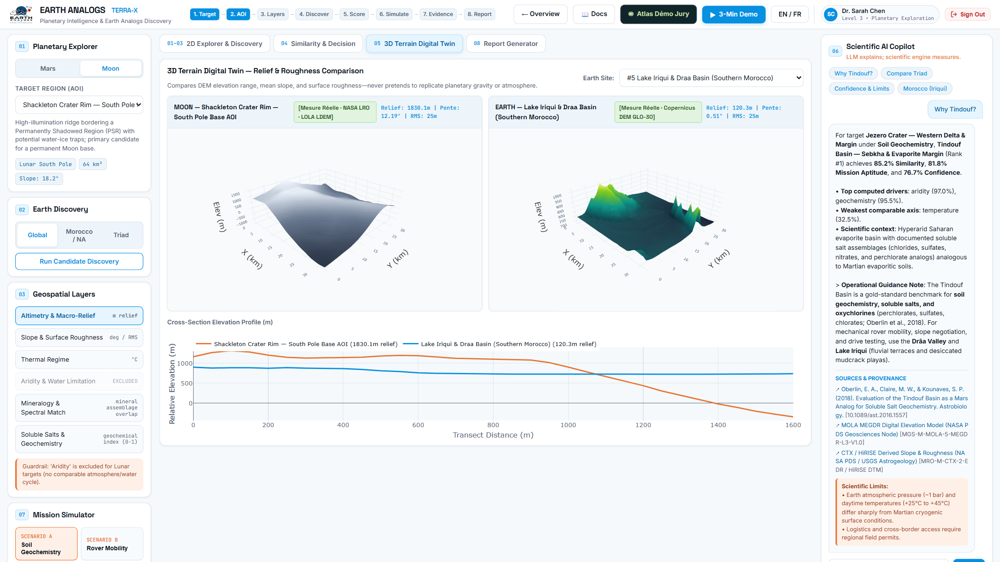  
*Figure 9: Dual-mesh 3D surface rendering with wireframe contours, interactive camera controls, and cross-section elevation transects.*

#### 1. Dual-Mesh Surface Rendering (`#plot-3d-aoi` & `#plot-3d-earth`)
- Leverages Plotly's WebGL surface renderer to project a $26 \times 26$ deterministic elevation grid.
- **Procedural Style Modulation**: The surface topography is mathematically modulated by the geological archetype of the site:
  - `delta_crater` (Jezero Crater): Raised circular crater rim ($h_{\text{rim}}$) with an intersecting fan delta deposit.
  - `polar_rim` (Shackleton Rim): Deep central depression with steep ridgelines and asymmetric illumination shadowing.
  - `mound_basin` (Gale Crater / Mount Sharp): Central central uplift mound surrounded by a moat basin.
  - `lava_pit` (Mare Tranquillitatis): Flat basaltic mare with a sharp collapsed circular void.
  - `clay_plain` / `evaporite` (Tindouf / Oxia Planum): Flat basin floor modulated by low-amplitude dunes and salt polygons.
- **Color Palettes**:
  - Mars AOI: Warm Martian Ochre (`YlOrRd`).
  - Moon AOI: Lunar Regolith Grayscale (`Greys`).
  - Earth Candidate: Terrestrial Topography (`Viridis` / `Blues`).

#### 2. Interactive Orbit & Inspection Controls
- **Left-Click + Drag**: 360-degree continuous rotation (azimuth and elevation angles).
- **Right-Click + Drag**: Pan surface mesh across coordinate space.
- **Scroll Wheel**: Smooth zoom into micro-relief structures.

#### 3. Cross-Section Elevation Profile Transect (`#plot-transect`)
- Extracts an equatorial slice ($Y = \text{center}$) through both meshes.
- Plots the relative elevation ($m$) along the transect distance ($m$).
- Allows rover engineers to visually evaluate slope breaks, boulder steps, and terrain hazards.

---

### Module 06: Scientific AI Copilot

Module 06 provides a context-aware, grounded scientific dialogue partner that explains scores, cites literature, and enforces scientific boundaries.

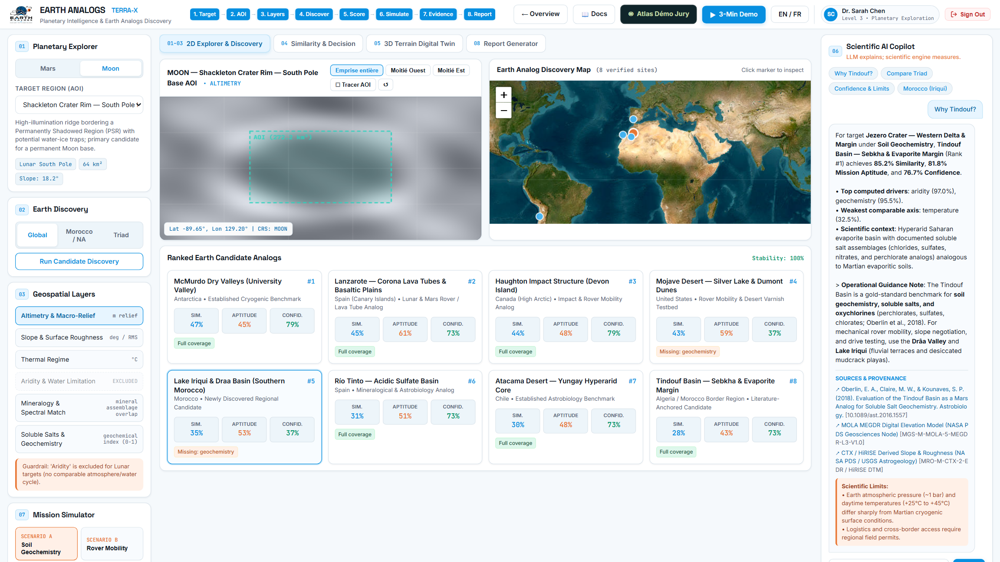  
*Figure 10: The Scientific AI Copilot delivering a grounded explanation of Tindouf Basin geochemistry with live score breakdowns and DOI citations.*

#### 1. Deterministic Grounded RAG Architecture ([engine/similarity.py](./engine/similarity.py#L436-L568))
The Copilot operates under strict anti-hallucination guardrails:
- **Zero Fabrication Rule**: The Copilot is barred from inventing scores, coordinates, or mission parameters.
- **Dynamic Context Ingestion**: Every response is assembled directly from the live computed analysis payload (active AOI, candidate ranks, criterion scores, missing data flags, and DOI metadata).
- **Peer-Reviewed Grounding**: Every claim is explicitly linked to published literature (e.g., *Oberlin et al., 2018*, DOI: `10.1089/ast.2016.1557`).

#### 2. Quick Prompt Chips (`#quick-prompts`)
- `Why Tindouf?`: Triggers a comprehensive breakdown of Tindouf Basin evaporites, explaining how high oxychlorine and sulfate concentrations drive its #1 ranking for Jezero Crater.
- `Compare Triad`: Produces a head-to-head comparison between Tindouf (Geochemistry), Atacama (Astrobiology), and McMurdo (Cryogenic Permafrost).
- `Confidence & Limits`: Audits data gaps, resolution discrepancies, and explicitly states why the candidate cannot simulate Lunar gravity or atmospheric pressure.
- `Morocco (Iriqui)`: Explains the geomorphology of Lake Iriqui and the Draa Basin as a rover mobility and clay basin analog.

#### 3. Optional Gemini API Synthesis
For users desiring expanded prose synthesis, an optional input field allows the inclusion of a Google Gemini API key. When provided:
- The grounded JSON context is forwarded to `gemini-2.5-flash` with strict instructions: *"Rewrite and synthesize ONLY the grounded scientific facts provided. Do NOT invent scores or claims."*
- If the key is omitted or an API error occurs, the platform seamlessly falls back to its deterministic local engine with zero service interruption.

---

### Module 07: Mission Scenario Simulator

Module 07 enables mission planners to simulate different operational objectives by adjusting multicriteria weighting profiles.

#### 1. Pre-Configured Mission Scenarios:
- **Scenario A: Soil Geochemistry (`soil_geochemistry`)**:
  - *Focus*: Salt crusts, perchlorates, sulfates, and clay mineral assemblages.
  - *Weights*: Geochemistry ($0.32$), Mineralogy ($0.28$), Aridity ($0.18$), Slope ($0.08$), Temp ($0.08$), Altimetry ($0.06$).
- **Scenario B: Rover Mobility & Trafficability (`rover_mobility`)**:
  - *Focus*: Terrain traversability, obstacle negotiation, wheel-slip hazards, slope stability.
  - *Weights*: Slope / Roughness ($0.40$), Altimetry ($0.24$), Mineralogy ($0.14$), Temp ($0.08$), Aridity ($0.08$), Geochem ($0.06$).
  - *Engineering Constraint*: Strict $20^\circ$ safe slope ceiling.
- **Scenario C: Cold / Arid Operations (`cold_arid`)**:
  - *Focus*: Sub-zero thermal survival, permafrost stability, ice sublimation.
  - *Weights*: Temperature ($0.38$), Aridity ($0.24$), Slope ($0.12$), Altimetry ($0.10$), Mineralogy ($0.08$), Geochem ($0.08$).
- **Scenario D: Astrobiology & Biosignatures (`astrobiology`)**:
  - *Focus*: Extreme desiccation, UV resistance, endolithic habitats, organic detection limits.
  - *Weights*: Aridity ($0.30$), Geochemistry ($0.24$), Mineralogy ($0.22$), Temp ($0.12$), Slope ($0.06$), Altimetry ($0.06$).

#### 2. Interactive "What-If" Weight Sliders (`#weight-sliders`)
- Six precision range sliders ($0\text{ to }60\%$) permit live adjustment of each criterion weight.
- **Real-Time Auto-Normalization**: As a slider is dragged, all weights are dynamically normalized to maintain $\sum w_i = 1.00$.
- **Live Re-Ranking**: Analysis queries are debounced ($140\text{ ms}$) and posted to `/api/missions/simulate`, updating rankings, heatmaps, and 3D digital twins in real time.
- **Reset Button (`#btn-reset-weights`)**: Restores weights to the active mission preset baseline.

---

### Module 08: Scientific Report Generator

Module 08 synthesizes all active analytical data into traceable, audit-compliant scientific reports.

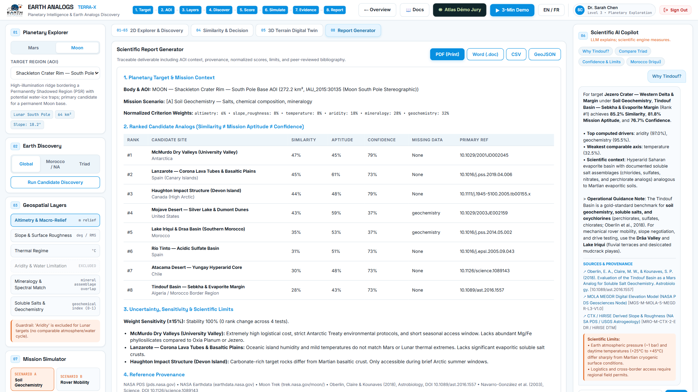  
*Figure 11: Tab 08 scientific report preview showing ranked candidates, sensitivity scores, scientific limits, and multi-format export CTAs.*

#### Multi-Format Export Capabilities:
1. **Printable PDF Export (`#export-pdf`)**:
   - Formats the report via clean `@media print` CSS rules, stripping interface sidebars and rendering crisp vectors, tables, and provenance blocks suitable for mission review panels.
2. **Microsoft Word Export (`#export-doc`)**:
   - Generates an HTML-based `.doc` file containing full table hierarchies, candidate statistics, and literature citations, fully editable in Microsoft Word or LibreOffice.
3. **Tabular CSV Export (`#export-csv`)**:
   - Streams a standard comma-separated file (`terra_x_<aoi_id>_report.csv`) containing site IDs, rankings, coordinates, similarity scores, mission aptitude scores, confidence ratios, and DOI identifiers.
4. **GeoJSON Boundary Export (`#export-geojson`)**:
   - Exports a valid `FeatureCollection` containing Point geometries for all candidate sites, complete with nested analytical properties, ready for immediate import into ArcGIS, QGIS, or NASA WorldWind.

---

## 7. Comprehensive Earth Analog Catalog & Benchmark Analysis

TERRA-X catalogs 8 extensively vetted terrestrial analog locations, each representing specific physical or geochemical dimensions of planetary exploration:

| Site Identifier | Site Name & Region | Primary Planetary Analog Focus | Key Mineral / Environmental Properties | Key Limitations |
| :--- | :--- | :--- | :--- | :--- |
| `tindouf_sebkha` | **Tindouf Basin Sebkha**<br>*(Algeria / Morocco Border)* | Mars Noachian Soil Geochemistry & Evaporite Salts | Oxychlorines ($\text{ClO}_4^-, \text{ClO}_3^-$), sulfates, nitrates, halite crusts | Terrestrial atmosphere ($1\text{ bar}$); summer daytime heat ($>45^\circ\text{C}$). |
| `iriqui_draa` | **Lake Iriqui & Draa Basin**<br>*(Southern Morocco)* | Martian Clay Plains & Rover Mobility Testbed | Expansive lacustrine clay flats, cracked mud polygons, dune fields | Subject to seasonal flash floods; modern biosphere contamination. |
| `atacama_yungay` | **Atacama Yungay Core**<br>*(Antofagasta, Chile)* | Astrobiology & Extreme Organic Detection Limits | Extreme hyperaridity ($<1\text{ mm/yr}$ rain), intense UV irradiation, nitrate deposits | High altitude ($>1000\text{ m}$); terrestrial gravity ($1g$). |
| `mcmurdo_dry_valleys`| **McMurdo Dry Valleys**<br>*(University Valley, Antarctica)* | Mars Amazonian Permafrost & Cryogenic Moon Base | Dry permafrost, thermal contraction crack polygons, hypolithic communities | High atmospheric oxygenation; coastal maritime proximity. |
| `haughton_impact` | **Haughton Impact Structure**<br>*(Devon Island, Canada)* | Lunar / Martian Impact Craters & Rover Traverse | Shatter cones, impact melt breccias, periglacial patterned ground | Arctic accessibility limited to 6-week summer window. |
| `rio_tinto` | **Río Tinto Basin**<br>*(Andalusia, Spain)* | Martian Acidic Sulfate & Jarosite Deposition | Extreme low pH ($1.5–2.5$), high ferric iron, jarosite, and goethite | High ambient moisture and continuous flowing water. |
| `lanzarote_volcanic` | **Lanzarote Volcanic Fields**<br>*(Canary Islands, Spain)* | Lunar & Martian Basalt Lava Tubes | Corona lava tube system, pristine tholeiitic basalts, low vegetation | Oceanic island environment; high marine humidity. |
| `mojave_desert` | **Mojave Desert (Silver Lake)**<br>*(California, USA)* | Rover Mobility, Wheel Abrasion & Desert Varnish | Playas, gravel pavements (*reg*), rock varnish coatings, dune fields | Active military airspace restrictions; tourist activity. |

---

## 8. REST API Specification & Programmatic Access

TERRA-X exposes a clean, synchronous REST API operating over HTTP/1.1 on port 8088.

### API Endpoints Summary

| Method | Endpoint Path | Description | Key Request Parameters | Response Format |
| :--- | :--- | :--- | :--- | :--- |
| `GET` | `/api/datasets` | Retrieve complete catalog metadata, criteria, and AOIs | Optional `?body=mars` or `?body=moon` filter | JSON Catalog Object |
| `POST` | `/api/regions/planetary` | Register or update target AOI boundary geometry | `{"aoi_id": "jezero_crater", "area_km2": 150.0}` | JSON Selected Region |
| `POST` | `/api/discovery/jobs` | Screen and filter candidate terrestrial analog sites | `{"mode": "global", "max_slope_deg": 25.0}` | JSON Completed Job |
| `POST` | `/api/analyses` | Execute end-to-end multicriteria evaluation | `{"aoi_id": "...", "mission_id": "...", "weights": {...}}` | JSON Analysis Result |
| `POST` | `/api/missions/simulate` | Alias for `/api/analyses` with What-If weight vectors | `{"aoi_id": "...", "weights": {"altimetry": 0.2, ...}}` | JSON Analysis Result |
| `POST` | `/api/terrain/compare` | Generate deterministic 3D elevation meshes | `{"aoi_id": "jezero_crater", "site_id": "tindouf_sebkha"}` | JSON 3D Grids & Transect |
| `POST` | `/api/copilot/query` | Query grounded AI Copilot for scores and citations | `{"question": "Why Tindouf?", "lang": "en"}` | JSON Grounded Answer |
| `POST` | `/api/reports` | Export scientific report in requested format | `{"format": "csv"}` (`json`, `csv`, `doc`, `geojson`) | JSON Export Payload |

---

## 9. Automated Verification, Unit Testing & Quality Assurance

To guarantee mathematical precision and software robustness, TERRA-X includes an automated test suite located in [tests/](./tests).

### 9.1 Test Execution Instructions
Run the automated test runner directly from PowerShell or Bash:
```powershell
python -m unittest discover -s tests -v
```

### 9.2 Key Test Assertions
1. **Normalization Integrity**: Verifies that any arbitrary weight vector is normalized strictly to $\sum w_i = 1.000000$.
2. **Guardrail Activation**: Asserts that when `body == "moon"`, aridity is assigned status `incompatible` and assigned a weight of zero.
3. **Decoupled Metric Invariance**: Asserts that high Similarity ($S_j$) does not automatically force high Mission Aptitude ($A_j$) or high Confidence ($C_j$).
4. **Rank Stability Calculation**: Validates that rank flip counters accurately register changes under $\pm 15\%$ weight perturbations.
5. **Deterministic Grounding**: Confirms that the AI Copilot returns verified DOI strings and refuses to output fabricated metrics.

---

## 10. Academic Bibliography & Open Science Provenance

The scientific credibility of TERRA-X is established upon the following peer-reviewed literature and planetary data nodes:

### Peer-Reviewed Publications
1. **Oberlin, E. A., Claire, M. W., & Kounaves, S. P. (2018)**. *Evaluation of the Tindouf Basin Region in Southern Morocco as an Analogue Site for Soil Geochemistry on Noachian Mars*. **Astrobiology**, 18(10), 1318–1328.  
   DOI: [10.1089/ast.2016.1557](https://doi.org/10.1089/ast.2016.1557)
2. **Osinski, G. R., Léveillé, R., Berinstain, A., Lebeuf, M., & Bamsey, M. (2006)**. *Terrestrial analogues to Mars and the Moon: Concepts, fidelity, and future exploration*. **Planetary and Space Science**, 54(11), 1045–1054.  
   DOI: [10.1016/j.pss.2006.05.010](https://doi.org/10.1016/j.pss.2006.05.010)
3. **Navarro-González, R., Rainey, F. A., McKay, C. P., et al. (2003)**. *Mars-Like Soils in the Atacama Desert, Chile, and the Dry Limit of Microbial Life*. **Science**, 302(5647), 1018–1021.  
   DOI: [10.1126/science.1089143](https://doi.org/10.1126/science.1089143)
4. **Marchant, D. R., & Head, J. W. (2007)**. *Antarctic dry valleys: Microclimate zonation, variable vitrification, and hyperarid regolith development as analogs for cold, dry Mars*. **Icarus**, 192(1), 187–222.  
   DOI: [10.1016/j.icarus.2007.06.018](https://doi.org/10.1016/j.icarus.2007.06.018)
5. **Martins, Z., et al. (2017)**. *Earth as a tool for astrobiology—A European roadmap for terrestrial analogues*. **Astrobiology**, 17(9), 807–849.  
   DOI: [10.1089/ast.2016.1585](https://doi.org/10.1089/ast.2016.1585)
6. **Preston, L. J., & Dartnell, L. R. (2014)**. *Planetary habitability: Lessons learned from terrestrial analogues*. **International Journal of Astrobiology**, 13(1), 81–98.  
   DOI: [10.1017/S1473550413000388](https://doi.org/10.1017/S1473550413000388)
7. **Lemelin, M., Lucey, P. G., et al. (2014)**. *Mineralogy and albedo of the Moon's South Pole-Aitken basin*. **Icarus**, 243, 8–16.  
   DOI: [10.1016/j.icarus.2014.07.030](https://doi.org/10.1016/j.icarus.2014.07.030)

### Space Agency Data Repositories & STAC Nodes
- **NASA Planetary Data System (PDS) Geosciences Node**: [https://pds.nasa.gov/](https://pds.nasa.gov/)
- **NASA Solar System Treks (Moon Trek / Mars Trek WMTS)**: [https://trek.nasa.gov/](https://trek.nasa.gov/)
- **USGS Astrogeology Planetary STAC API**: [https://stac.astrogeology.usgs.gov/](https://stac.astrogeology.usgs.gov/)
- **Copernicus Data Space Ecosystem (ESA Sentinel-2 & COP-DEM)**: [https://dataspace.copernicus.eu/](https://dataspace.copernicus.eu/)
- **NASA Earthdata Common Metadata Repository (CMR)**: [https://earthdata.nasa.gov/](https://earthdata.nasa.gov/)

---
*End of Technical Platform Guide — TERRA-X Consortium (NASA Space Apps 2026)*
